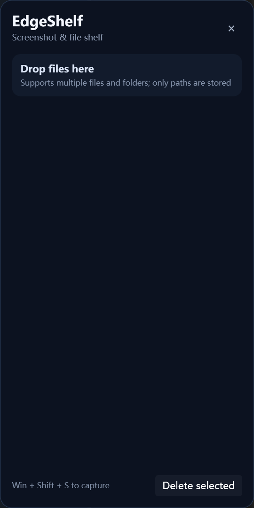

<div align="center">

# EdgeShelf

**屏幕边缘的截图与文件中转站**

截图后随手收纳，选好文件直接拖出，不用反复打开文件夹。

Windows 桌面 · C# / WPF · .NET 10 · 中文 / English

**简体中文** · [English](README.en.md)

**源码公开 · 仅限非商业用途** — [PolyForm Noncommercial 1.0.0](LICENSE.md)

</div>

## 项目预览

<p align="center">
  
</p>
<p align="center"><sub>实际应用截图 · 英文界面 · 空侧栏状态</sub></p>

## EdgeShelf 是什么？

EdgeShelf 是一个运行在 Windows 屏幕右侧的截图与文件暂存工具。它把截图、临时文件和文件夹集中到一个可收起的侧栏中，适合整理待发送图片、汇集不同目录的文件，再拖到支持文件拖放的软件中。

平时收起不占用整块屏幕；需要时从边缘唤出把手，或拖着文件靠近边缘展开。它是临时中转站，不是云盘，也不是文件备份工具。

## 核心功能

| 功能 | 当前行为 |
| --- | --- |
| 原生截图收纳 | 使用 `Win + Shift + S` 截图，剪贴板中的图片自动进入侧栏 |
| 文件与文件夹中转 | 从资源管理器拖入多个项目，记录原路径，不另行复制原文件 |
| 框选与批量拖出 | 从列表空白处或顶部提示区框选，再从已选卡片上左键拖出，无需按 Alt |
| 贴边收起 | 普通悬停显示把手，点击把手展开；外部文件拖到边缘时自动展开；鼠标离开后约 3 秒收起 |
| 预览与固定 | 截图缩略图、双击截图预览；右键固定，让截图不受自动过期清理影响 |
| 保留时间 | 截图可保留 1 小时、24 小时、7 天或永久，默认 24 小时 |
| 托盘设置 | 支持显示侧栏、开机启动、截图保留时间、中文 / English 切换和退出 |
| 本地持久化 | 条目和设置保存在本机，重启后恢复；源文件不可用时显示提示 |

> 应用监听的是剪贴板图片，而不只是截图工具。因此，其他软件复制到剪贴板的图片也可能被收纳。拖出时采用 Windows 文件拖放格式，接收效果取决于目标软件。

## 快速上手

1. **启动并展开**：运行应用，将鼠标移到屏幕右侧触发区域，点击出现的把手。也可右键托盘图标，选择“显示侧栏”。
2. **收纳截图**：按 `Win + Shift + S` 完成截图，图片进入剪贴板后会自动加入侧栏。
3. **收纳文件**：在资源管理器中选中文件或文件夹，拖到屏幕右侧，侧栏展开后松开。
4. **多选并拖出**：在列表空白处或“把文件拖到这里”区域按住左键框选，然后从任一已选卡片上拖动整组项目到目标软件。文件卡片本身用于拖出，不是普通框选的起点。
5. **管理条目**：右键项目固定或移除，或使用“删除所选”。截图可双击预览。

### 设置在哪里？

右键 Windows 通知区域中的 **EdgeShelf 托盘图标**；图标也可能在“显示隐藏的图标”面板中。当前设置通过托盘菜单提供，没有独立的设置窗口。

- **语言 / Language → 中文 / English**：切换界面语言，选择自动保存。
- **截图保留时间**：选择 1 小时、24 小时、7 天或永久。修改后，现有未固定截图会从修改时刻重新计算有效期。
- **开机启动**：开启或关闭 Windows 登录后启动。
- **显示侧栏 / 退出**：重新显示窗口或完全退出程序。右上角 `×` 只隐藏侧栏，不退出应用。

3 秒收起延时目前是程序内置值，尚未提供自定义设置。

## 获取与构建

**当前仓库提供源码，尚未发布可下载的 EXE Release。** 仓库的“Download ZIP”下载的是源码包，不是安装包。

### 环境

- 面向 Windows 10 / 11 x64。
- 从源码构建需要安装 **.NET 10 SDK**，仅安装运行时不足以编译。
- 首次还原依赖时需要能连接 NuGet。

在 Windows PowerShell 中执行：

```powershell
git clone https://github.com/dhmingzi358746-create/EdgeShelf.git
cd EdgeShelf
dotnet restore
dotnet run -c Release
```

### 发布单文件 EXE

```powershell
dotnet publish -c Release -r win-x64 --self-contained true `
  -p:PublishSingleFile=true `
  -p:IncludeNativeLibrariesForSelfExtract=true
```

输出文件：

```text
bin/Release/net10.0-windows/win-x64/publish/EdgeShelf.exe
```

此发布方式包含 .NET 运行时，目标电脑无需另外安装 .NET。请保留 `IncludeNativeLibrariesForSelfExtract=true`，以将 WPF 所需的本机库一并打包。

## 数据与隐私

应用数据保存在当前用户目录下：

```text
%LOCALAPPDATA%/EdgeShelf/
├── cache/          自动收纳的图片缓存
├── items.json      项目路径、固定状态和过期时间
└── settings.json   保留时间、开机启动和语言设置
```

- 应用本身不会上传截图或文件内容，也不需要账号或云服务；用户拖到其他软件后的处理由目标软件负责。
- 手动拖入的文件与文件夹只保存原路径，源文件移动、重命名或删除后，对应条目可能失效。
- `items.json` 包含本机文件路径，分享诊断材料前请检查是否包含个人信息。

> **删除行为请留意：**移除手动拖入的文件只会删除侧栏条目，不会删除原文件；移除自动收纳的截图会删除其缓存图片。未固定截图过期后也会自动清理缓存。“固定”仅阻止自动过期，不阻止手动删除。重要图片请另存备份。

## 技术实现

- **C# + WPF / .NET 10**：Windows 桌面窗口、列表和拖放交互。
- **[WPF UI](https://github.com/lepoco/wpfui) 4.3.0**：深色主题与 Fluent 风格控件。
- **Windows 剪贴板监听**：接收剪贴板图片并保存为 PNG。
- **Windows 文件拖放**：通过标准文件列表传递选中项目。
- **JSON 本地存储**：保存条目与设置。

## 反馈与当前范围

项目仍在迭代中，目前聚焦 Windows 右侧贴边交互；多显示器、不同 DPI 和不同软件的拖放兼容性仍需更多验证。暂不提供 macOS / Linux 版本、云同步或独立设置窗口。

欢迎通过 [Issues](https://github.com/dhmingzi358746-create/EdgeShelf/issues) 反馈问题或提出需求。建议附上 Windows 版本、显示缩放比例、目标软件、复现步骤和脱敏截图；请勿上传完整的个人缓存或含敏感路径的配置。

## 许可与致谢

**本项目源码公开，采用 [PolyForm Noncommercial License 1.0.0](LICENSE.md)，仅限许可证允许的非商业用途，不授权商业使用。**

- 可按许可证条款用于非商业学习、研究、个人使用、修改和再分发。
- 不授权将本项目或其衍生版本用于收费销售、商业产品、付费服务等商业用途；其他商业使用同样需要权利人另行许可。
- 再分发时须附带许可证全文或其链接，以及 [NOTICE](NOTICE) 中的必要声明。
- 此处是使用范围摘要，具体定义、允许用途、例外与义务以 [LICENSE.md](LICENSE.md) 正文为准；软件按现状提供。

因为包含非商业限制，准确分类是 **source-available（源码可见 / 源码公开）**，而不是符合 [OSI 开源定义](https://opensource.org/osd) 的无商用限制开源许可。

感谢 [WPF UI](https://github.com/lepoco/wpfui) 提供控件与主题。第三方依赖仍遵循其各自许可证（例如 WPF UI 的 MIT）；本项目的非商业许可不改变第三方代码本身的许可条款。
